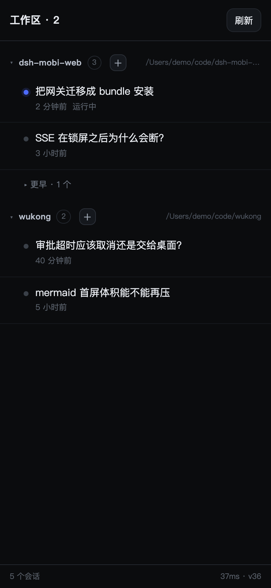

# dsh-mobi-web

A phone-first web client for **DeepSeek Harness**, served by a sidecar gateway that runs *inside* the harness process.

> **Not `dsh-mobile-gateway`.** There is an unrelated npm package by that name ("scan a QR code + settings page + live sync"). This one is different: a **32 KB page** instead of a proxied UI, **approvals that stay on the phone when the phone started the turn**, and Mermaid rendered on the device. The repo directory is still `dsh-mobi-web-plugin`; the package is `dsh-mobi-web`.

```
phone browser  ──HTTPS──▶  Cloudflare tunnel / Tailscale  ──▶  127.0.0.1:3083 (this plugin)  ──▶  harness host services
```

## Read this first: what you are exposing

Holding the login token means **operating this machine through the harness**. The gateway proxies the whole harness, not just chat:

- send prompts, and read every session on the machine (history included)
- approve tool calls — **including shell commands** — and answer "yes" on your behalf
- with approvals, run anything the harness itself could run

So: **put it behind Tailscale** (a private tailnet) rather than a public tunnel unless you know what you are doing, use a token you generated for this and nothing else, and never reuse a password from another service. The token is stored in `$DSH_HOME/dsh-mobi-web-token` (mode 0600) and the log prints only its *path*.



## Why this exists

The official web UI ships ~4.6 MB of JavaScript. Over a relayed mobile link (0.4 MB/s in practice) that is ten-plus seconds of white screen, and the layout assumes a trackpad. This gateway serves a **~32 KB** page instead and talks to the same host services in-process, so it can do things a proxied UI cannot — like holding an approval the desktop never sees.

## What you get

**Browse**
- Sessions grouped by workspace, newest activity first (same `SessionSummary.updatedAt` the desktop orders by)
- Split into *active* (running, or touched within 24 h) and *older* (collapsed, remembered per workspace)
- Archived sessions are filtered out; workspace collapse state persists

**Read**
- Markdown: headings, lists, tables, blockquotes, links, inline code, fenced code
- Mermaid fenced blocks render as SVG; tap one to open it full-screen (pan + pinch), tap again to close
- Long messages fold to ~460 px with "展开全文"
- Live token streaming: the reply grows word by word

**Do**
- Send multi-line text (Enter inserts a newline; the send button is the only way to send)
- Send images (up to 4, inline base64, 4 MB each)
- Stop a running turn
- Create a session in any workspace (`＋` on the workspace header)
- Jump back to the newest message

**Approve**
- Approval requests arrive as cards over SSE
- **Origin affinity**: if the *phone* started the turn, the approval stays on the phone. It waits up to 15 minutes, then **cancels** — it never falls back to a desktop nobody is sitting at. Desktop-origin turns keep the old behaviour (20 s grace, then hand back).

**Stay up**
- SSE with exponential-backoff reconnect (2 s → 30 s) and a 6 s poll as fallback
- The gateway lives inside the harness process, so it starts and stops with it — no separate daemon to supervise

## Install

The plugin is a DSH **bundle**: it ships its own `cordis.patch.yml`, so no profile file is edited by hand. There are two install paths, because the desktop profile is special.

**Web / other profiles** — the npm CLI:

```bash
dsh plugin --profile web add dsh-mobi-web     # from npm
dsh plugin --profile web add link:/path/to/dsh-mobi-web-plugin   # from a checkout
```

**The desktop profile** — `desktop` is reserved for the Electron-owned profile, and the *npm* CLI refuses to manage it. Install through the app's **plugin manager**, or with the Desktop-installed command (`dsh` inside the app bundle):

```bash
dsh plugin --profile desktop add dsh-mobi-web
```

Either way, after `add` the package is in `package.json` → `dsh.profile.bundles` (the CLI reconciles that list by inspecting each dependency's `dsh.bundle` declaration). **A new bundle only mounts on restart** — adding it changes nothing until the app or `dsh` starts again.

Then expose the port:

```bash
tailscale serve --bg 3083          # phone on the same tailnet
# or a Cloudflare tunnel ingress: host → http://127.0.0.1:3083
```

Open `https://<your-host>/m/`.

**The password.** If you do not set `token` in the patch config, one is minted on first start and written to `$DSH_HOME/dsh-mobi-web-token` (mode 0600). The startup log prints *where* it is, not the token itself — `cat` that file to read it. (The token is echoed only when the file could not be written, i.e. when that process holds the only copy.) Set `token: '…'` to choose your own, or `token: false` to disable the gate — only on a network you fully trust.

To override anything, add a row to your profile's `cordis.patch.yml`. A patch **replaces the row's whole `config` object**, so restate every non-default value:

```yaml
- id: dsh-mobi-web
  config:
    listenHost: '127.0.0.1'
    listenPort: 3083
    blockPaths: ['/dsh-whale/']
```

## Configuration

| key | default | meaning |
| --- | --- | --- |
| `listenHost` | `127.0.0.1` | never bind wider; a tunnel does the rest |
| `listenPort` | `3083` (bundle patch; the code default is `3080`) | |
| `token` | auto-minted file | password for the cookie gate; `false` disables it |
| `allowTokenUrl` | `false` | accept `?t=…` links (leaks via history, off by default) |
| `blockPaths` | `[]` | path prefixes answered `204` to keep the page light |
| `approvalPriority` | `'phone-first'` | `'desktop'` disables interception entirely |
| `pwa` | `true` | inject manifest + icon into the proxied UI |
| `brotli` | `true` | recompress JS for the proxied UI |

## Routes

| route | what |
| --- | --- |
| `GET /m/` | the mobile page (cookie-gated) |
| `GET /m/api/sessions` | workspace-grouped list (10 s cache) |
| `GET /m/api/session?id=` | messages (newest 40 / 120 k chars) + pending approvals |
| `GET /m/api/events?session=` | SSE: `state`, `message`, `astart`, `adelta`, `aend`, `tool`, `approval`, `approval-done` |
| `POST /m/api/prompt` | `{id, text, images[]}` — verifies the message actually landed |
| `POST /m/api/cancel` | interrupt the running turn |
| `POST /m/api/create` | `{cwd}` → new session |
| `POST /m/api/approve` | `{id, decision}` |
| `GET /__gw/health` | unauthenticated liveness |
| `GET /__gw/stats` | counters + approval diagnostics (cookie-gated) |

## Design notes

- **No `0.0.0.0`.** `dsh` refuses to start on a non-loopback host, so a sidecar proxy is the only option; the tunnel terminates TLS outside.
- **Cookie minting happens server-side.** Letting the launch-token flow redirect through `303` dropped the `SameSite=Strict` cookie on iOS, producing `ERR_TOO_MANY_REDIRECTS`.
- **Every request handler is wrapped in try/catch.** dsh treats an uncaught exception as fatal; a sidecar must never crash the host.
- **The profile links the checkout.** Editing `lib/index.js` and restarting is the deploy; `lib/page.html` is read per request, so it needs no restart at all.

## Limits worth knowing

- Single user, single host. No account model beyond one shared token.
- No push notifications: if the phone is asleep, an approval waits for you (up to 15 min) rather than pinging you.
- Images inside *historical* messages render as `[图片]` — only the fact they existed is kept.
- Mermaid is vendored (857 KB brotli), lazy-loaded on the first diagram.
- Sessions cannot be moved between workspaces — DSH derives membership from the session's `cwd` at creation.
- **Compatibility**: verified on DSH `0.2.2-rc.1`. The gateway reads host services through `ctx.get('sessionQuery')` and friends — private API, not a stable contract. A dsh upgrade may break it; the page and the HTTP layer would keep working.

## Repo layout

```
lib/index.js      the gateway plugin (single file on purpose)
lib/page.html     the mobile page, served from disk on every request
assets/           vendored mermaid (js + gz + br) and the app icon
cordis.patch.yml  bundle patch — the install declaration
test/             27 tests, fake host services, no network
```

## Tests

```bash
node --test test/*.test.mjs    # 27 tests, no network, fake host services
```
